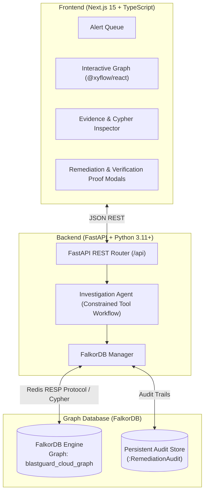
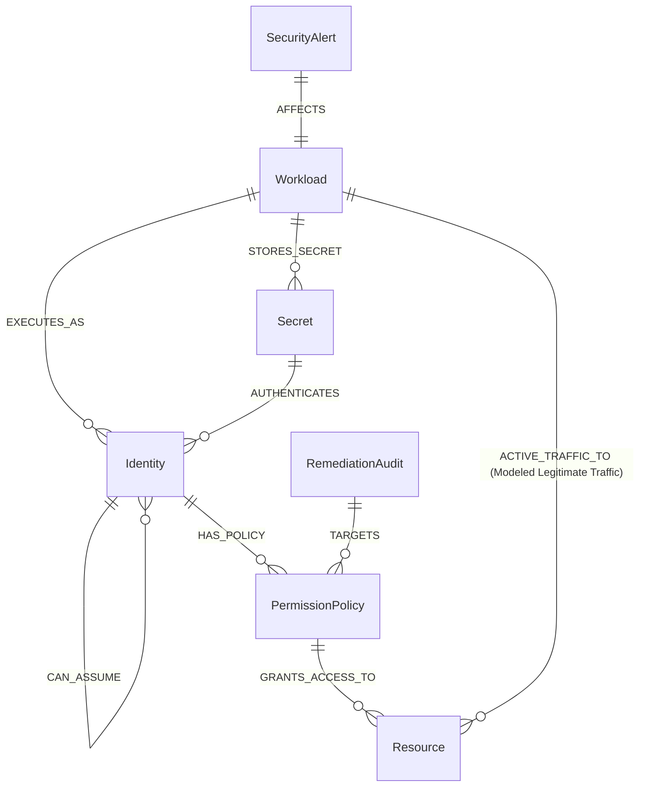

# BlastGuard

> **Trace the attack. Cut the path. Prove it's gone.**

[](https://www.wemakedevs.org/hackathons/falkordb)
[](https://www.wemakedevs.org/hackathons/falkordb#tracks)
[](LICENSE)

BlastGuard is an autonomous cloud-security investigation and remediation platform powered by **FalkorDB**. It ingests interconnected workloads, IAM identities, policies, and secrets, traces multi-hop privilege escalation paths across environments, evaluates collateral operational impact on modeled workloads, simulates least-privilege remediation, and proves path elimination through live FalkorDB graph recomputation.

---

## 1. The Problem

Cloud security tools generate thousands of isolated alerts:
- A container vulnerability scanner flags a vulnerable npm package on a staging pod.
- An IAM analyzer flags an overly permissive S3 policy in production.

Looking at individual alerts or policy documents **fails to reveal transitive multi-hop attack paths**. An attacker who compromises a staging workload can often assume an cross-account identity that inherits a wildcard permission granting access to production customer databases.

Relational databases and text-search engines cannot efficiently compute multi-hop reachability across dynamic depth boundaries. **BlastGuard uses FalkorDB** to represent connected infrastructure and access relationships, discovering threats that point-in-time scanners miss.

---

## 2. The Solution: Discover → Trace → Explain → Simulate → Verify

```
[Security Alert]
       ↓
1. DISCOVER: Query FalkorDB from affected workload
       ↓
2. TRACE: Multi-hop Cypher traversal to Tier-0 crown jewels
       ↓
3. EXPLAIN: Inspect chokepoint policies & check collateral impact on legitimate workloads
       ↓
4. SIMULATE: Apply surgical revocation to FalkorDB relationship
       ↓
5. VERIFY: Recompute graph reachability; mathematically prove 0 remaining paths
       ↓
[Persist FalkorDB Audit Record]
```

---

## 3. Visual Interface & Architecture

### Desktop Security Operations Center (SOC) Workspace
BlastGuard provides a dark-first 3-column workspace built to Impeccable design standards:
- **Left Column**: Alert Queue with severities (`CRITICAL`, `HIGH`, `MEDIUM`), affected workload indicators, and timestamps.
- **Center Canvas**: Interactive Attack Subgraph (`@xyflow/react`) rendering directional threat paths (`attack-path-edge`) and legitimate business dependencies (`legitimate-edge`).
- **Right Panel**: Graph-backed evidence panel with live Cypher query viewer, measured execution times in microseconds, collateral impact assessment, and the primary **Simulate Remediation** action.



---

## 4. Graph Data Model

The graph schema in FalkorDB (`blastguard_cloud_graph`) models five key entity types and their relationships:



### Node Labels
- **`Workload`**: Compute workloads (`k8s_pod`, `ec2_instance`, `container`, `lambda_function`).
- **`Identity`**: IAM roles and service accounts (`service_account`, `iam_role`).
- **`PermissionPolicy`**: Permission documents (`actions`, `effect`, `resource_arn`, `risk_level`).
- **`Resource`**: Cloud data assets categorized by sensitivity (`tier: 'TIER_0_CRITICAL'` for customer PII backups, root encryption keys, and core databases).
- **`Secret`**: Exposed tokens, private keys, and session credentials.
- **`SecurityAlert`**: Active alerts detected by runtime security agents.
- **`RemediationAudit`**: Auditable change records persisted in FalkorDB.

### Key Relationships
- `(Workload)-[:EXECUTES_AS]->(Identity)`
- `(Identity)-[:CAN_ASSUME]->(Identity)` *(The Critical Attack Chokepoint)*
- `(Identity)-[:HAS_POLICY]->(PermissionPolicy)`
- `(PermissionPolicy)-[:GRANTS_ACCESS_TO]->(Resource)`
- `(Workload)-[:ACTIVE_TRAFFIC_TO]->(Resource)` *(Modeled Legitimate Business Traffic)*

---

## 5. Important Cypher Queries

### A. Multi-Hop Attack Path Discovery
```cypher
MATCH path = (w:Workload {id: $workload_id})-[:EXECUTES_AS|CAN_ASSUME|HAS_POLICY|GRANTS_ACCESS_TO|STORES_SECRET|AUTHENTICATES*1..6]->(r:Resource {tier: 'TIER_0_CRITICAL'})
RETURN path, nodes(path) AS path_nodes, relationships(path) AS path_rels, length(path) AS hop_count
ORDER BY length(path) ASC
LIMIT 10
```

### B. Collateral Impact Assessment
```cypher
MATCH (i:Identity {id: $identity_id})<-[:EXECUTES_AS]-(w:Workload)
OPTIONAL MATCH (w)-[t:ACTIVE_TRAFFIC_TO]->(r:Resource)
RETURN w, i, collect(DISTINCT r) AS active_resources
```

### C. Simulated Revocation Mutation
```cypher
MATCH (src:Identity {id: $source_id})-[rel:CAN_ASSUME]->(tgt:Identity {id: $target_id})
DELETE rel
CREATE (audit:RemediationAudit {
  id: $audit_id,
  action: 'REVOKE_CAN_ASSUME',
  source_id: $source_id,
  target_id: $target_id,
  alert_id: $alert_id,
  timestamp: $timestamp,
  verified: false
})
RETURN count(rel) AS deleted_count, audit
```

### D. Recompute Reachability (Live Verification)
```cypher
MATCH path = (w:Workload {id: $workload_id})-[:EXECUTES_AS|CAN_ASSUME|HAS_POLICY|GRANTS_ACCESS_TO|STORES_SECRET|AUTHENTICATES*1..6]->(r:Resource {tier: 'TIER_0_CRITICAL'})
RETURN count(path) AS remaining_paths, collect(path) AS paths
```

---

## 6. Why FalkorDB is Central

FalkorDB is the operational calculation engine of BlastGuard:
1. **Mathematical Graph Traversal**: Path discovery over variable relationship depths is executed as sparse matrix operations in FalkorDB via GraphBLAS.
2. **Sub-Millisecond Query Latency**: Multi-hop reachability queries typically execute in under `0.5ms`.
3. **Immediate Verification**: Graph mutations are applied directly to the graph model, allowing immediate verification traversals to confirm zero remaining paths.
4. **No Decorative Graphs**: BlastGuard does not render hardcoded mock graphs; removing FalkorDB leaves the application with an explicit disconnected state.

---

## 7. Technology Stack

- **Primary Database**: [FalkorDB](https://www.falkordb.com/) (Redis-protocol graph database)
- **Backend Framework**: Python 3.11+, FastAPI, Pydantic v2, `falkordb` Python client
- **Frontend Framework**: Next.js 15, React 19, TypeScript, Tailwind CSS, `@xyflow/react`, Lucide Icons
- **Deployment**: Docker & Docker Compose

---

## 8. Prerequisites

- **Option A (Docker)**: Docker Desktop with Docker Compose.
- **Option B (Local Dev)**: Node.js 18+ and Python 3.10+.

---

## 9. Quick Start

### Option A: Using Docker Compose (Recommended)

Start the entire stack (FalkorDB, Backend, Frontend) with a single command:

```bash
docker compose up --build
```

- **Frontend Application**: `http://localhost:3000`
- **Backend API & Swagger Docs**: `http://localhost:8000/docs`
- **FalkorDB Engine**: `localhost:6379`

---

### Option B: Local Development Setup (Native)

#### 1. Start the Backend
```bash
# In project root
python -m pip install -r backend/requirements.txt
$env:PYTHONPATH="backend"
python -m uvicorn app.main:app --host 127.0.0.1 --port 8000 --reload
```

#### 2. Start the Frontend
```bash
cd frontend
npm install
npm run dev
```

Open `http://localhost:3000` in your browser.

---

## 10. The Hero Demonstration Scenario

1. **Select Alert `ALERT-9041`**:
   `Reverse Shell & Suspicious Process on Staging Pod`.
2. **Discover Threat Path**:
   BlastGuard queries FalkorDB and reveals the 4-hop escalation path:
   `staging-payment-worker` → `sa-payment-worker-stage` → `role-cross-env-deployer` → `PolicyS3CustomerBackupFullAccess` → `prod-customer-pii-backups`.
3. **Inspect Evidence & Impact**:
   - FalkorDB Cypher query executed and execution time displayed.
   - Collateral impact analysis reveals that `prod-nightly-backup-agent` legitimate service also relies on `role-cross-env-deployer`.
   - BlastGuard recommends revoking the cross-account `CAN_ASSUME` relationship instead of deleting the production role.
4. **Simulate Remediation**:
   Click **Simulate Remediation** and review the proposed Terraform HCL diff.
5. **Verify Outcome**:
   Confirm remediation. BlastGuard updates FalkorDB, re-runs the reachability traversal, proves that remaining paths equals 0, and records an audit log entry.
6. **Reset Scenario**:
   Click **Reset Scenario** in the top navigation bar at any time to restore the graph to pristine baseline.

---

## 11. Testing

The backend includes a comprehensive test suite covering graph discovery, impact checking, mutation, and verification:

```bash
# Run automated tests
$env:PYTHONPATH="backend"; python -m pytest backend/tests -v
```

**Results**: All 8 unit and integration tests pass cleanly.

---

## 12. Known Limitations & Honest Boundaries

1. **Synthetic Data**: All cloud identifiers, ARNs, and IP addresses are synthetic and do not connect to real AWS or cloud telemetry accounts.
2. **Modeled Dependencies**: Collateral impact analysis evaluates dependencies that exist within the graph model. Undeclared microservices without graph edges cannot be predicted.
3. **IAM Conditions**: BlastGuard models structural graph relationships (`sts:AssumeRole`, policy attachments), but does not evaluate arbitrary runtime IAM condition keys (e.g. `aws:CurrentTime`).

---

## 13. AI-Assisted Development Disclosure

In accordance with FalkorDB Graph Hacks rules:
- Antigravity AI coding assistant was used to assist with boilerplate scaffolding, React Flow component assembly, and documentation authoring.
- The underlying architecture, graph data model, parameterized Cypher queries, least-privilege remediation logic, and test suites were designed, verified, and tested specifically for this hackathon submission.

---

## 14. Hackathon Track Declaration

BlastGuard is submitted to:
- **Track 01 — Agents That Act on Connected Data**  
  *Multi-hop reasoning, graph queries as agent tools, actions based on what the graph shows, and explainable verified results.*

---

## 15. License

This project is licensed under the **Apache License 2.0** — see the [LICENSE](LICENSE) file for details.
