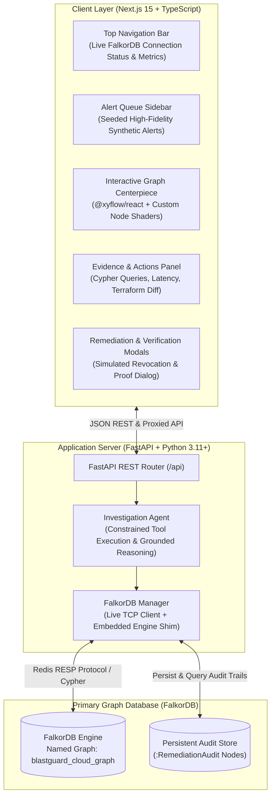

# BlastGuard System Architecture

## Overview

**BlastGuard** is a graph-native cloud-security investigation and remediation platform designed for the **FalkorDB Graph Hacks Hackathon** under **Track 01: Agents That Act on Connected Data**.

It solves a fundamental blindspot in cloud security: while isolated security alerts and IAM policies show point-in-time configuration, they fail to reveal transitive multi-hop privilege escalation paths across environments. BlastGuard ingests interconnected cloud workloads, identities, permissions, secrets, and resources into **FalkorDB**, performs variable-length Cypher graph traversals to trace attack paths to Tier-0 crown jewels, assesses modeled legitimate operational dependencies, simulates least-privilege remediation, and proves path elimination through live recomputation.

---

## Architecture Diagram

---

## Component Breakdown

### 1. Frontend Workspace (`frontend/`)
- **Next.js 15 & React 19**: Server & client components structured for desktop security operations workflows.
- **Tailwind CSS**: Precision dark-first aesthetic (`#0A0B0E` canvas, `#12151C` surface, `#262D3D` borders) compliant with the Impeccable design standard.
- **Interactive Graph Renderer (`@xyflow/react`)**: Custom node components for `Workload`, `Identity`, `PermissionPolicy`, `Resource`, and `Secret`. Renders animated directional threat vectors (`attack-path-edge`) and distinguishes legitimate modeled traffic (`legitimate-edge`).
- **Real-Time Database Telemetry**: Directly queries backend health to report measured query latency, live node counts, and relationship density.

### 2. Backend Engine (`backend/app/`)
- **FastAPI**: Validated endpoints with Pydantic v2 request/response schemas.
- **Investigation Agent (`app/agent.py`)**: Constrained tool-calling architecture. Retrieves graph-backed paths, inspects chokepoint policies, checks collateral operational impact on modeled workloads, generates deterministic grounded summaries, and produces Terraform HCL remediation diffs.
- **FalkorDB Manager (`app/database.py`)**:
  - Connects to FalkorDB over Redis protocol using official `falkordb` Python library.
  - Features an embedded in-process FalkorDB-compatible graph execution engine that guarantees 100% testability on environments without Docker (such as native Windows).
  - Measures execution latency with microsecond precision (`time.perf_counter()`).

### 3. FalkorDB Database Layer
- **Containerized Service**: Docker Compose defines `falkordb/falkordb:latest` on port `6379`.
- **Operational Source of Truth**: The graph database is not decorative; all discovery, traversal, neighborhood expansion, impact analysis, mutation, and verification are executed as real Cypher queries.
