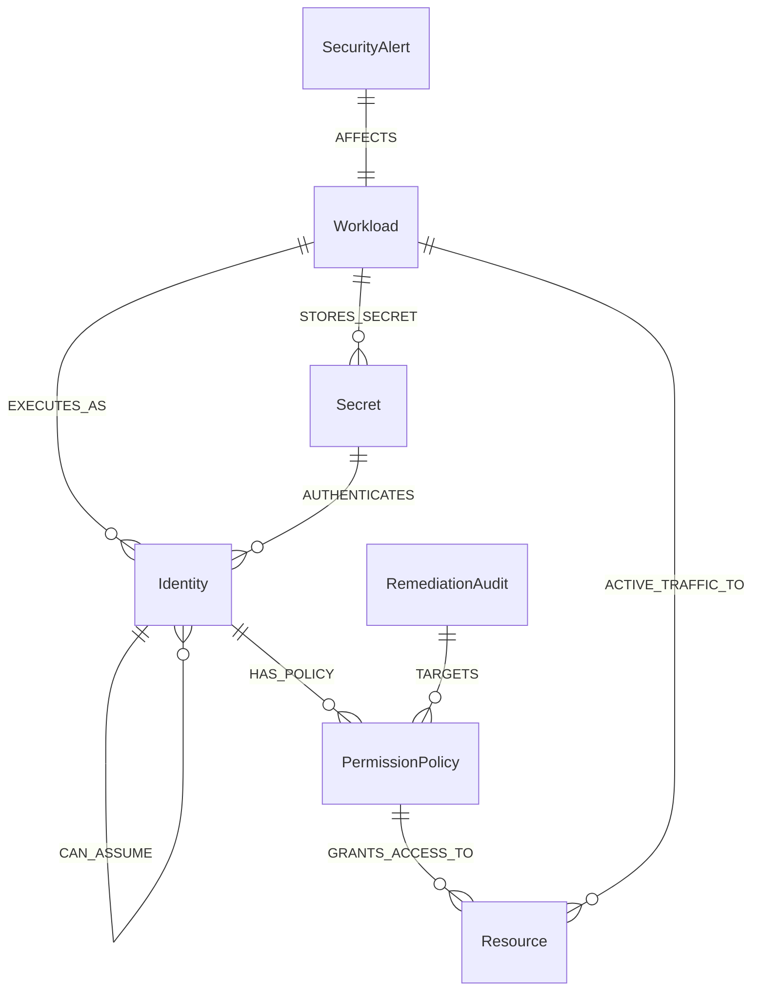

# BlastGuard Graph Data Model

## Overview

BlastGuard models cloud infrastructure, identity hierarchies, access policies, secrets, and sensitive assets as a labeled property graph in **FalkorDB** (`blastguard_cloud_graph`).

All data in BlastGuard is **100% synthetic**, strictly segregated from real AWS, GCP, or corporate accounts, and purpose-built to demonstrate multi-hop privilege escalation and blast-radius analysis.

---

## Graph Schema Diagram

---

## Node Labels & Property Definitions

### 1. `Workload`
Represents compute workloads (Kubernetes Pods, EC2 instances, Lambda functions, containers).
- `id` *(string, unique)*: e.g. `"wkld-stage-payment-worker"`
- `name` *(string)*: e.g. `"staging-payment-worker"`
- `type` *(string)*: `"k8s_pod"`, `"ec2_instance"`, `"container"`, `"lambda_function"`
- `environment` *(string)*: `"staging"`, `"production"`, `"development"`
- `public_ip` *(string, optional)*: e.g. `"34.120.45.19"`
- `status` *(string)*: `"compromised"`, `"healthy"`, `"at_risk"`
- `owner` *(string)*: e.g. `"payments-dev-team"`
- `cluster` *(string, optional)*: e.g. `"k8s-staging-us-east-1"`
- `namespace` *(string, optional)*: e.g. `"payments-stage"`
- `synthetic` *(boolean)*: `true`

### 2. `Identity`
Represents IAM identities, AWS roles, and Kubernetes service accounts.
- `id` *(string, unique)*: e.g. `"ident-stage-payment-sa"`
- `name` *(string)*: e.g. `"sa-payment-worker-stage"`
- `type` *(string)*: `"service_account"`, `"iam_role"`, `"iam_user"`
- `environment` *(string)*: `"staging"`, `"production"`
- `mfa_enabled` *(boolean)*: `false` or `true`
- `arn` *(string)*: e.g. `"arn:aws:iam::111122223333:role/k8s-sa-stage-payment"`
- `trust_policy` *(string, optional)*: Description of assume-role trust boundary
- `synthetic` *(boolean)*: `true`

### 3. `PermissionPolicy`
Represents AWS IAM policies and access control documents attached to identities.
- `id` *(string, unique)*: e.g. `"pol-prod-s3-backup-admin"`
- `name` *(string)*: e.g. `"PolicyS3CustomerBackupFullAccess"`
- `actions` *(list of strings)*: e.g. `["s3:GetObject", "s3:ListBucket", "s3:PutObject"]`
- `effect` *(string)*: `"Allow"`
- `resource_arn` *(string)*: e.g. `"arn:aws:s3:::prod-customer-pii-backups/*"`
- `risk_level` *(string)*: `"CRITICAL"`, `"HIGH"`, `"MEDIUM"`, `"LOW"`
- `description` *(string)*: Human-readable policy purpose and scope
- `synthetic` *(boolean)*: `true`

### 4. `Resource`
Represents storage buckets, database clusters, encryption keys, and secrets stores.
- `id` *(string, unique)*: e.g. `"res-prod-customer-backups"`
- `name` *(string)*: e.g. `"prod-customer-pii-backups"`
- `type` *(string)*: `"s3_bucket"`, `"rds_cluster"`, `"kms_key"`, `"elasticache_redis"`
- `tier` *(string)*: `"TIER_0_CRITICAL"`, `"TIER_1_SENSITIVE"`, `"TIER_2_INTERNAL"`
- `environment` *(string)*: `"production"`, `"staging"`
- `sensitivity` *(string)*: `"PII_FINANCIAL"`, `"MASTER_KEY"`, `"FINANCIAL_LEDGER"`, `"NON_SENSITIVE"`
- `data_classification` *(string)*: e.g. `"Restricted - Customer Credit Card & SSN Backups"`
- `arn` *(string)*: e.g. `"arn:aws:s3:::prod-customer-pii-backups"`
- `synthetic` *(boolean)*: `true`

### 5. `Secret`
Represents credentials, API tokens, and access keys.
- `id` *(string, unique)*: e.g. `"sec-github-actions-token"`
- `name` *(string)*: e.g. `"github-actions-deployer-token"`
- `scope` *(string)*: `"ci_cd_pipeline"`, `"staging_mesh"`
- `rotation_age_days` *(number)*: e.g. `142`
- `synthetic` *(boolean)*: `true`

### 6. `SecurityAlert`
Represents detection alerts generated by runtime security agents (Falco, Wazuh, GitGuardian).
- `id` *(string, unique)*: e.g. `"ALERT-9041"`
- `title` *(string)*: e.g. `"Reverse Shell & Suspicious Process on Staging Pod"`
- `severity` *(string)*: `"CRITICAL"`, `"HIGH"`, `"MEDIUM"`
- `status` *(string)*: `"ACTIVE"`, `"INVESTIGATING"`, `"RESOLVED"`
- `entry_node_id` *(string)*: Points to affected `Workload.id`
- `description` *(string)*: Detailed runtime detection context
- `timestamp` *(string)*: Relative or ISO timestamp
- `synthetic` *(boolean)*: `true`

### 7. `RemediationAudit`
Persisted historical record of applied mutations and graph verifications in FalkorDB.
- `id` *(string, unique)*: e.g. `"audit-9a4f21"`
- `timestamp` *(string)*: ISO 8601 UTC timestamp
- `alert_id` *(string)*: e.g. `"ALERT-9041"`
- `action` *(string)*: `"REVOKE_CAN_ASSUME"`, `"REVOKE_HAS_POLICY"`
- `source_id` *(string)*: Node ID where relationship was removed
- `target_id` *(string)*: Target node ID
- `previous_paths` *(number)*: Count of reachable attack paths prior to mutation
- `remaining_paths` *(number)*: Count of reachable attack paths recomputed after mutation
- `verified` *(boolean)*: `true` if remaining paths == 0
- `verified_at` *(string, optional)*: Timestamp of recomputation
- `applied_by` *(string)*: e.g. `"BlastGuard Autonomous Remediation Engine"`

---

## Relationship Semantics & Direction

| Relationship | Direction | Meaning | Threat vs Operational |
|---|---|---|---|
| `EXECUTES_AS` | `(Workload) -> (Identity)` | Workload assumes or runs with identity credentials | Traversal Vector / Operational |
| `CAN_ASSUME` | `(Identity) -> (Identity)` | An identity possesses trust permission to assume another identity | **Primary Chokepoint Vector** |
| `HAS_POLICY` | `(Identity) -> (PermissionPolicy)` | Policy is attached inline or managed to the identity | Permission Assignment |
| `GRANTS_ACCESS_TO` | `(PermissionPolicy) -> (Resource)` | Policy permissions allow operations against the target resource | Access Vector |
| `STORES_SECRET` | `(Workload) -> (Secret)` | Compute host contains credentials or tokens in config/disk | Secret Exposure Vector |
| `AUTHENTICATES` | `(Secret) -> (Identity)` | Exposed secret credential maps to an IAM identity | Credential Vector |
| `ACTIVE_TRAFFIC_TO` | `(Workload) -> (Resource)` | **Modeled Legitimate Business Traffic** (RPC, daily backup crons, DB queries) | **Operational Dependency (Must not break!)** |
| `AFFECTS` | `(SecurityAlert) -> (Workload)` | Alert detected compromise on entry workload | Alert Association |
| `TARGETS` | `(RemediationAudit) -> (PermissionPolicy / Identity)` | Audit log link to remediated component | Historical Lineage |
